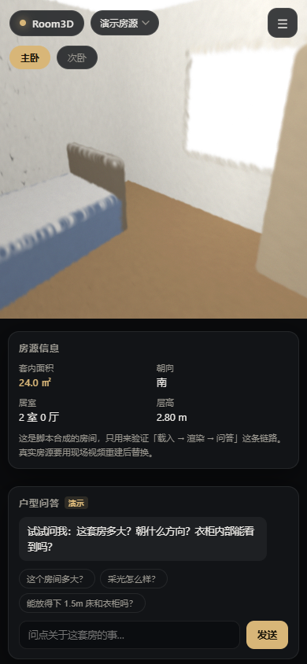
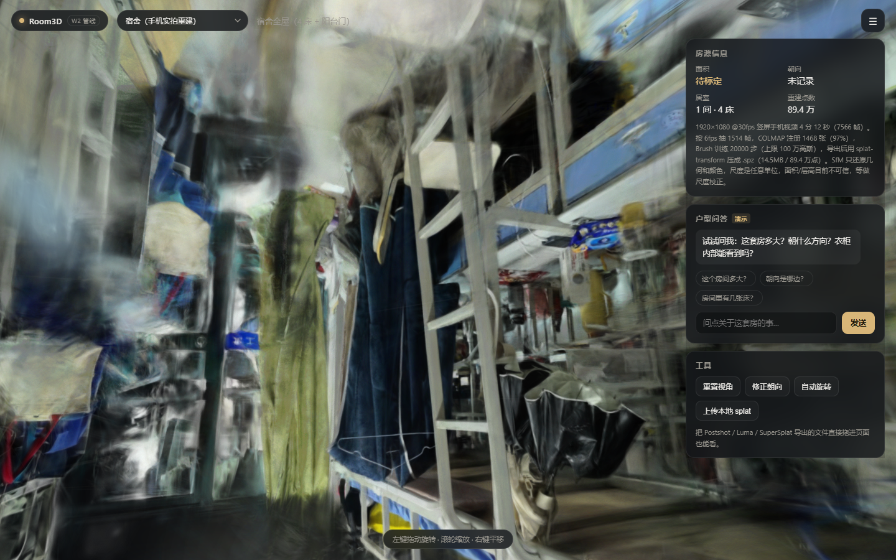
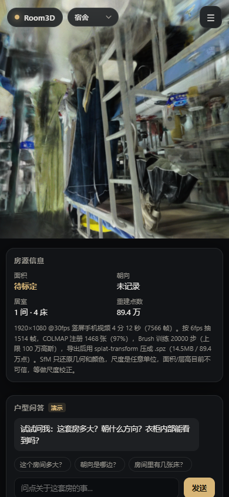

# Room3D · 3D 房源漫游（W1 骨架 + W2 一键管线）

手机拍一段视频 → 重建成高斯泼溅场景 → 网页里转着看房 → 用问答读户型。

**线上预览：https://ai1s.github.io/room3d/** （GitHub Pages，静态托管，已验证可渲染 / 可切房源；部署细节见 [docs/deploy.md](docs/deploy.md) 的 2C 节）

- **W1（已完成）**：先证明「一个链接打开就能 3D 看房 + 问问题」这条路通，场景用脚本合成的房间代替。
- **W2（本次）**：把「视频 / 重建产物 → 网页房源」串成一条命令，并加好静态部署配置。

> 仓库自带三套房源：`scans/demo`（脚本合成的两居室，演示用）、`scans/selftest`（W2 管线自测：把演示场景转成 3DGS PLY 再转回 .splat 的往返结果，28079 点）
> 和 `scans/dorm`（**手机实拍的真实宿舍**：1080p30 竖屏 4 分 12 秒 → 6fps 1514 帧 → COLMAP 注册 1468 张（97%）→ Brush 训练 100 万点 → .spz 14.5 MB / 89.4 万点）。
> 顶栏的「房源下拉」就是切这三套；自己跑一次 `pipeline.py` 就会多出一套。




手机实拍宿舍（真实重建，不是合成场景）：




## 现在能做什么

| 能力 | 状态 | 说明 |
| --- | --- | --- |
| 3D 高斯泼溅场景加载 | ✅ | Spark 渲染器，支持 .ply / .splat / .ksplat / .spz / .sog |
| 手机 + 桌面自适应 | ✅ | 手机上 3D 视口自动让出下半屏给信息面板 |
| 多房间切换 | ✅ | 一个房源内多个场景（主卧 / 次卧） |
| 房源库切换 | ✅ W2 | 顶栏下拉，读 `scans/index.json`，2 套以上才出现；`#/scan/<id>` 可直接分享链接 |
| 户型信息卡 | ✅ | 面积、朝向、居室、重建点数 |
| 户型问答（规则替身） | ✅ | 预置问题 + **拒答分支**（没采集到的直接说"无法查看"） |
| 本地文件直接拖进来 | ✅ | 拿 Postshot / Luma / SuperSplat 导出的文件免部署也能看 |
| 朝向修正 / 自动旋转 / 重置视角 | ✅ | 真实扫描常见"躺平/倒挂"，一键切 Y↑ / Z↑ （着急了，好像有点问题）|
| **3DGS PLY → .splat 转换** | ✅ W2 | `scripts/ply_to_splat.py`：SH0 颜色、log 尺度、四元数编码、透明度剪枝、降采样 |
| **视频 → 发布一条龙** | ✅ W2 | `py scripts/pipeline.py`：抽帧 → 收重建产物 → 转格式 → 发布 → 重建索引 |
| **静态部署配置** | ✅ W2 | `vercel.json` + `public/_headers`（Cloudflare Pages），.splat 走 octet-stream + 长缓存 |
| **真实手机视频重建** | ✅ W2 | 宿舍实拍 4 分 12 秒 → 1468/1514 帧注册 → 89.4 万点 / 14.5 MB；一键脚本 `scripts/rebuild.sh`（COLMAP + Brush，本地免费） |
| **发布格式 spz / sog** | ✅ W2 | 同一份 100 万点重建：.splat 32 MB → .spz 14.5 MB → .sog 10.9 MB（`--format`） |
| **真实机位默认视角 + 自动裁剪** | ✅ W2 | `--camera-from`（从 COLMAP 位姿算默认机位写进 `meta.camera`）、`--crop-cameras`（按相机包围盒裁飘浮点） |
| 上传视频 → 抽帧 API | ✅ | FastAPI（只在本地跑），需要本机装 ffmpeg |
| VLM 出结构化 JSON | ⬜ W4 | meta.json 现在是手写的 / 管线生成占位，W4 由 VLM 生成 |
| LLM 问答 | ⬜ W5 | 现在是关键词匹配的替身，顺序（先判"不能答"）已经定好 |

## 跑起来

```bash
# 1) 装依赖（node 18+）
npm install

# 2) 生成两个示例房间（纯 python 标准库，无第三方依赖）
npm run sample        # = py scripts/make_sample_splat.py

# 3) 开发模式（热更新，http://localhost:5173）
npm run dev

# 4) 或者构建后预览（http://localhost:4173）
npm run build && npm run preview
#    注意用 localhost 而不是 127.0.0.1：vite 默认只监听 IPv6 的 localhost
```

后端（可选，只有网页上传视频/抽帧才需要）：

```bash
py -m pip install -r requirements.txt
py -m uvicorn server.main:app --reload --port 8000
# 自检： curl http://127.0.0.1:8000/api/health
```

> Windows 上 `python` 可能不在 PATH，用 `py`。前端 `npm run dev` 只把 `/api` 代理到 8000。

## W2：一条命令把视频变成网页房源

```bash
# A. 从视频开始（会自动抽帧，然后停在"该重建了"这一步）
py scripts/pipeline.py --video D:/dorm.mp4 --id dorm --title 宿舍

# B. 重建产物已经有了（Postshot 导出的 ply / 现成的 splat）
py scripts/pipeline.py --id dorm --title 宿舍 --splat "C:/Users/me/Downloads/dorm.ply"

# C. 抽帧抽过了，只补重建产物
py scripts/pipeline.py --id dorm --title 宿舍 --skip-frames --splat C:/x/dorm.ply

# D. 手工改了 meta.json / 加了新目录之后，只重建索引
py scripts/pipeline.py --reindex     # = npm run index
```

管线做了什么：

1. **抽帧**：`ffmpeg -vf fps=2,scale=min(1600,iw):-2` → `data/scans/<id>/frames/`（没装 ffmpeg 会直接告诉你装法：`winget install Gyan.FFmpeg`）
2. **收重建产物**：`--splat` 指定 / 把 PLY 丢进 `data/scans/<id>/rebuild/` / `--rebuild-cmd` 跑自己的命令（`{frames}` `{out}` 占位符）
3. **转格式**：`ply_to_splat.py` 把 3DGS PLY 转成 32 B/点的 .splat（默认剪掉透明度 < 0.005 的点）
4. **发布**：`public/scans/<id>/scene.splat` + `meta.json`（面积/朝向占位），最后重写 `public/scans/index.json`

重建这步脚本**不替你跑**（要 GPU）：推荐 **Postshot**（Windows 图形界面，直接导视频最省事）。
把导出 PLY 丢进 `data/scans/<id>/rebuild/` 再跑一次管线即可。

常用参数：

```bash
--max-points 800000     # 发布版压到 80 万点（手机低端机能跑）
--up z-to-y            # COLMAP/部分 3DGS 导出是 Z 朝上，转成 Y 朝上
--quat-order xyzw      # 画面出现"梳齿/条纹"时切这个（四元数分量顺序不对）
--keep-meta            # 只换 splat，保留已经填好的 meta.json
```

## 本地一键重建（COLMAP + Brush，不花钱路线）

W2 的管线默认"重建这步你自己跑（Postshot）"。这条是本机全自动版本，一条命令从视频跑到网页房源：

```bash
bash scripts/rebuild.sh data/test2.mp4 dorm --title "宿舍 2 号床"
# = npm run rebuild -- data/test2.mp4 dorm --title "宿舍 2 号床"
```

它做的事（每步都有耗时输出）：

| 步骤 | 工具 | 说明 |
| --- | --- | --- |
| 1. 抽帧 | ffmpeg | 默认 2 fps，长边 1600 |
| 2. 位姿 + 稀疏点云 | COLMAP 4.2.1 | feature_extractor → sequential_matcher(overlap 10) → mapper |
| 3. 训练高斯泼溅 | Brush 0.3.0 | headless，默认 15000 步、sh_degree 0、最多 200 万点、最多 600 帧 |
| 4. 导出 + 发布 | ply_to_splat + pipeline.py | PLY → .splat → `public/scans/<id>/` → 重建索引 |

**建图失败会自动加帧率重试一次**：先 2 fps，注册率 < 1/3 就换 6 fps 再来一遍（帧间重叠更多）。两轮都失败说明这条视频不能用，按 [docs/capture-sop.md](docs/capture-sop.md) 重拍。

本机工具位置（不在 PATH 里，脚本会自动找；换机器就设环境变量 `FFMPEG` / `COLMAP_BIN` / `BRUSH_BIN`）：

```
C:\Users\liaos\AI\tools\3dgs\colmap\bin\colmap.exe     # COLMAP 4.2.1 (CUDA)
C:\Users\liaos\AI\tools\3dgs\brush\brush_app.exe         # Brush 0.3.0（GUI 和 CLI 是同一个 exe）
%LOCALAPPDATA%\Microsoft\WinGet\Packages\Gyan.FFmpeg_*\...\bin\ffmpeg.exe
```

都要自己下（约 570 MB）：COLMAP 放 [colmap releases](https://github.com/colmap/colmap/releases) 的 `colmap-x64-windows-cuda.zip`；Brush 放 [brush releases](https://github.com/ArthurBrussee/brush/releases) 的 `brush-app-x86_64-pc-windows-msvc.zip`。

> 为什么不用 nerfstudio splatfacto：Windows 上编译 tiny-cuda-nn 很痛苦。Brush 是 Rust 写的、单 exe、直接吃 COLMAP 数据集、自带 CUDA 训练，4090 Laptop 上开箱能用。
> 想要更好画质/更多控制就换 Postshot（GUI）或 LSplat，产物照样能用 `pipeline.py --splat` 接管。

## 部署（静态站）

前端是纯静态的，`vite.config.js` 里 `base: './'`，丢到任何静态托管都能跑。
**完整步骤（GitHub 建仓 → push → Vercel/CF 部署 → 上线自检 4 条）见 [docs/deploy.md](docs/deploy.md)**，这里只放最短路径。

**Vercel**

```bash
vercel login    # 本机已装 CLI（66.6.0）
npm run deploy  # = vercel --prod，第一次会问项目名，选 room3d，其余按默认
# 只想要预览链接：npm run deploy:preview
```

> Windows 上 CLI 首次部署可能报 `EPERM ... symlink ... builders-vlt`（系统不让普通进程建符号链接）。
> 遇到就直接用**网页导入**：vercel.com → Add New → Project → 选 GitHub 仓库 → Deploy，构建在云端跑。
> 想坚持用 CLI 就开「开发者模式」或用管理员终端。

`vercel.json` 已配好：构建命令、输出目录，以及 `/scans/*.splat` 返回 `application/octet-stream` + 一年长缓存（不配的话有些浏览器会把 .splat 当文本处理）。

**Cloudflare Pages**

构建命令 `npm run build`，输出目录 `dist`，仓库里 `public/_headers` 会被拷进 `dist/_headers`，缓存头自动生效。

**Netlify / GitHub Pages**：构建命令同上，发布目录 `dist` 即可。

> ⚠️ **后端 FastAPI 不部署**：抽帧、上传这些只在本地跑。线上只有 `dist/` 里的静态文件（网页 + .splat + meta.json）。
> 所以别人打开链接只能看，不能上传；想给人上传再单独找带 GPU 的后端，W2 不做。
> 另：`.splat` 单个文件建议 ≤ 15 MB，GitHub/Vercel 单文件上限是 100 MB，别把 200 MB 的高清版塞进仓库。

## 目录

```
room3d/
├─ index.html                 # 单页骨架：顶栏 / 房源下拉 / 场景切换 / 信息面板 / 问答 / 工具
├─ src/
│  ├─ main.js                 # 渲染 + 载入 + 相机适配 + 房源库 + 问答（W1 用规则替身）
│  └─ style.css               # 深色 + 金色点缀，移动端改底部抽屉
├─ public/
│  ├─ _headers                # Cloudflare Pages 缓存头
│  └─ scans/
│     ├─ index.json           # 房源列表（pipeline.py 生成，前端顶栏下拉读它）
│     ├─ demo/                # 合成示例：meta.json + scene.splat(6.9MB) + scene2.splat(5.0MB)
│     └─ <id>/                # 真实房源：scene.splat + meta.json
├─ scripts/
│  ├─ rebuild.sh              # 本地一键重建：视频 → COLMAP → Brush → 发布
│  ├─ pipeline.py             # W2 一键管线：视频/PLY → public/scans/<id>/
│  ├─ ply_to_splat.py         # 3DGS PLY → .splat 转换（numpy 可选，纯 stdlib 也能跑）
│  ├─ make_sample_splat.py    # 生成示例 .splat（合成房间，无第三方依赖）
│  └─ extract_frames.py       # 单独抽帧（调 ffmpeg）
├─ server/main.py             # FastAPI：/api/health、上传视频抽帧、上传 splat、列举
├─ docs/
│  ├─ deploy.md               # 部署手册：GitHub → Vercel / Cloudflare Pages
│  ├─ capture-sop.md          # 拍摄 SOP（拍之前看这份）
│  ├─ log.md                  # 踩坑时间线：报错原文 + 当时的误判 + 修法
│  ├─ roadmap.md              # 8 周计划 + 验收标准
│  └─ screenshots/            # 验收截图
├─ vercel.json                # 部署配置（构建命令 + .splat 的 content-type / 缓存头）
└─ requirements.txt
```

## 接一个真实场景（完整 checklist）

1. 按 `docs/capture-sop.md` 拍 2–3 分钟视频（锁 AE/AF、1x、走慢三步、回起点闭合）；
2. `py scripts/pipeline.py --video D:/scan.mp4 --id mine --title 我家` → 自动抽帧，停在"该重建了"；
3. Postshot 导入视频或 `data/scans/mine/frames/`，训练完导出 PLY；
4. 把 PLY 丢进 `data/scans/mine/rebuild/`，再跑 `py scripts/pipeline.py --id mine --title 我家 --skip-frames`；
5. `npm run dev` 打开就能看到，顶栏下拉切房源；方向不对点「修正朝向」或在管线里加 `--up z-to-y`；
6. 打开 `public/scans/mine/meta.json` 填面积/朝向/居室/FAQ，把关键尺寸用卷尺或 A4 纸核一遍。

## 已知坑（踩过并修好的，别再踩）

- **`/scans` 不要做代理**：演示数据在 `public/`，vite 里把 `/scans` 代理到后端会导致 502。现在只代理 `/api`。
- **ffmpeg 找不到 ≠ 没装**：本机其实装着（winget 的 Gyan 包），只是没进 PATH → `where ffmpeg` 为空。先 `winget list` 查，别急着重装；管线会自己按「PATH → 硬编码目录」找。
- **PLY 转完"表面像梳子/条纹"**：四元数分量顺序不对，加 `--quat-order xyzw` 重转（3DGS 官方是 wxyz）。
- **COLMAP 4.2 参数改名**：`--SiftExtraction.use_gpu` → `--FeatureExtraction.use_gpu`，`--SiftMatching.use_gpu` → `--FeatureMatching.use_gpu`。写旧名字会直接报错退出。
- **Brush 没有 `brush.exe`**：压缩包里只有 `brush_app.exe`，不加 `--with-viewer` 就是纯命令行训练。
- **COLMAP 只注册了 2 张图**（`Discarding reconstruction due to no initial pair`）：抽帧间隔太长 / 手持转太快，相邻帧没有重叠。实测 2 fps 对着快速扫视的视频会全军覆没，把 fps 提到 6–10 再试。
- **真实场景"躺平"或"倒挂"**：COLMAP 常是 Z 朝上，加 `--up z-to-y`；临时看可以在网页点「修正朝向」。
- **手机上看不到场景中心**：3D 画布会占满整屏而面板压住下半屏 → 看到的是一片墙。已用 `layout()` 把画布高度让出来。
- **vite 只监听 IPv6**：用 `localhost:5173` 打开；`127.0.0.1` 可能连不上（手机预览要加 `--host`）。
- **dev server 开着的时候改 `src/` 里的文件**：Windows 上偶尔报 `EIO`/`ReplaceFileW`（文件被 vite 监听占用），先停 dev server 再改。
- **大文件**：场景是 7 MB 左右的静态文件，先看进度条（`onProgress`），不要以为卡死。
- **打包体积**：`three` + `spark` 打包后 JS 约 3.2 MB（gzip 1.08 MB）。W2 只做了 .splat 长缓存，代码拆分留到以后。
- **Brush 训练出来整体飘在相机外面（网页里一团雾）**：数据目录里只要有**第二个 COLMAP 模型**（`sparse2/`、旧 attempt 目录残留），Brush 0.3.0 就会"随便挑一个 points3D.bin"当初始点，于是 A 模型的相机配 B 模型的点。给它的目录必须只有一个 `sparse/0`；`scripts/rebuild.sh` 现在会自动搭 `bset/`（单模型 + `images` 目录联接）。
- **网页里是雾/放射条纹，但 Brush 自己的 eval 图是清楚的**：先查发布时有没有盲目降采样（见体积账最后一行的警告），再看默认机位——相机落在场景包围盒外面时 3DGS 只能渲染出雾。用 `--camera-from <sparse/0>` 让管线把真实机位写进 `meta.camera`。
- **splat-transform 的参数顺序**：动作（`-B` 裁剪、`-d` 降采样、`-r` 旋转）必须写在**输入文件之后**，写在前面会被静默忽略（输出还是没裁过的）。
- **更多报错原文和当时的误判**：见 [docs/log.md](docs/log.md)——按阶段记的踩坑时间线（COLMAP 参数改名、Brush 没有 brush.exe、代理、Vercel 的 EPERM 软链等）。

## 体积账（为什么不像原方案那样卡 100 MB）

| 格式 | 每点字节 | 200 万点 | 本机实测（宿舍，100 万点训练 / 89.4 万点发布） |
| --- | --- | --- | --- |
| 3DGS PLY (sh0) | 56 B | 112 MB | 100 万点 = 53 MB |
| .splat | 32 B | 64 MB | 100 万点 = 32 MB |
| .spz | ~17 B | 34 MB | **89.4 万点 = 14.5 MB** |
| .sog | ~14 B | 28 MB | 100 万点 = 10.9 MB |

结论：**别写"整包 ≤ 100 MB"**，写成"首屏按 LOD 流式加载，单房间首屏 ≤ 15 MB"。
管线默认 `--format spz`：同一份 100 万点重建，`.splat` 32 MB、`.spz` 14.5 MB、`.sog` 10.9 MB。

> ⚠️ 别为了省体积盲目 `--max-points` 降采样：实测把 408 万点砍到 80 万点后，该模型 opacity 中位数只有 0.042，
> 点一稀就整体半透明，网页里看起来就是"一团雾"。要么提高训练质量，要么只裁离群点（`--crop-cameras`）。

## 注意问题

- **不承诺"面积准确"**：房产面积是产权证概念，平台只提供「户型尺寸参考 + 关键尺寸可核验」。
- **不脑补未采集区域**：镜头没进过的地方统一回"没有采集到，无法查看"。
- **后台保留人工复核**：所有尺寸标为"重建量测参考值"。
-powered with DSH
